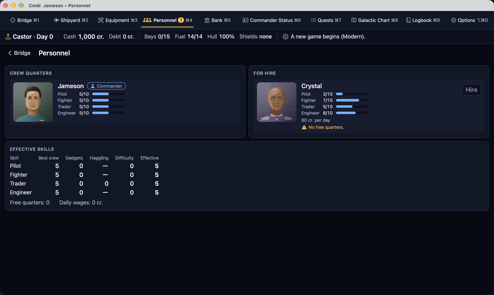
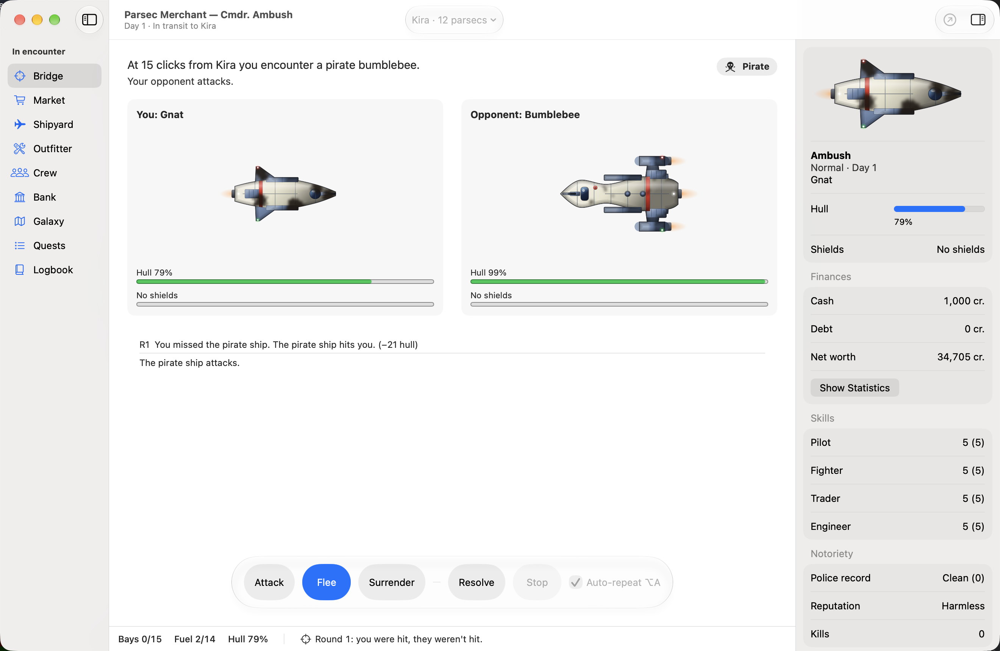
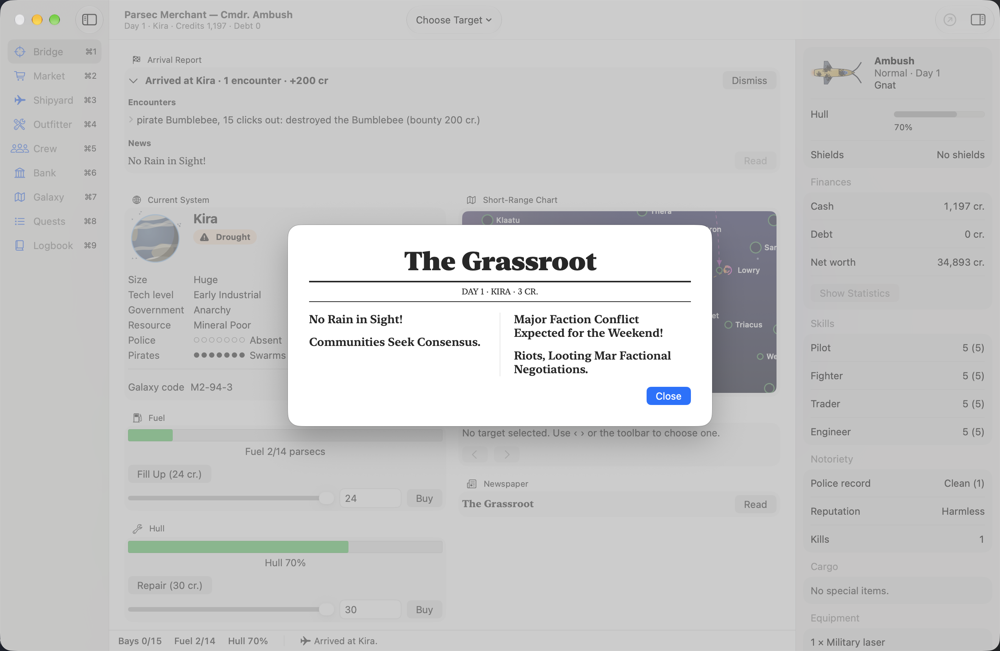
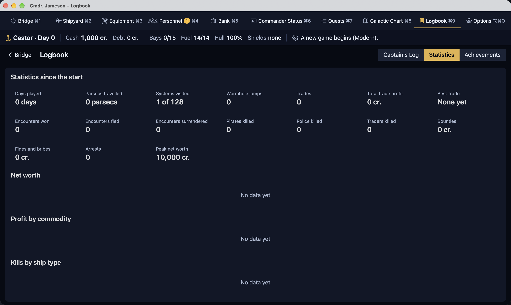
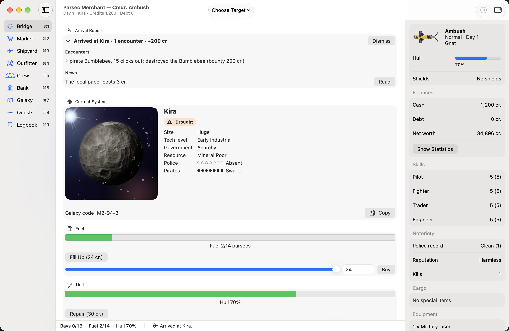
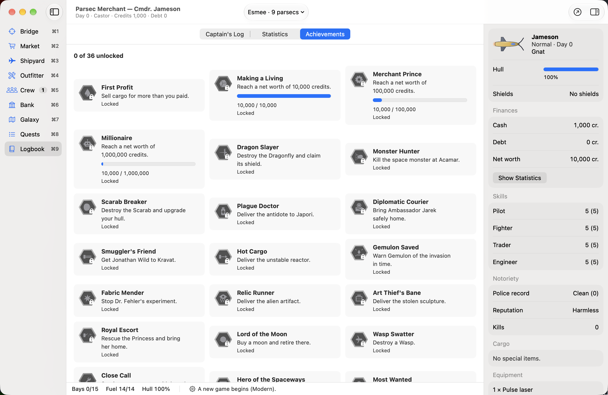

<div align="center">


# Parsec Merchant

**A native macOS remake of Space Trader, Pieter Spronck's classic Palm OS trading game.**<br>
Buy low, sell high, dodge pirates and police, take on quests, and earn enough to retire to a moon of your own.

[](https://github.com/megatih/parsec-merchant/releases/latest)
[](LICENSE)
[](#install)
[](https://www.swift.org)
[](#build-from-source)

[**Download**](https://github.com/megatih/parsec-merchant/releases/latest) ·
[Screenshots](#screenshots) ·
[Install](#install) ·
[Build from source](#build-from-source) ·
[How it's built](#how-its-built) ·
[Credits](#credits)

<br>

<picture>
  <source media="(prefers-color-scheme: dark)" srcset="docs/screenshots/readme-bridge-dark.png">
  
</picture>

</div>

## Highlights

- **The original rules, three ways.** Pick a ruleset when you start a new game (see [Rulesets](#rulesets)).
- **One screen for the whole trade run.** The Bridge shows the system, the cargo market with ten goods, the Short-Range Chart and the Target System at once: buy, sell, refuel, repair, compare destinations and warp without leaving it. A dock bar opens the other pages (Shipyard, Equipment, Personnel, Bank, Commander Status, Quests, Galactic Chart, Logbook, Options), and a status bar always shows cash, debt, bays, fuel, hull and shields.
- **A cargo table that does the arithmetic.** Each row shows what you hold and paid, the prices here and at your target, and the profit per unit. A Quantity field with Buy, Max, Sell and All on every row does the trading, and Sell All Cargo empties the hold in one click.
- **Made for the pointer, complete from the keyboard.** Every action is a visible button with a 36-point target and its key printed on it; the same commands are in the menu bar (File, Edit, View, Trade, Game, Encounter). The whole trade loop also works without the pointer: arrows, B and S, ⌘] and ⌘J.
- **A zoomable Galactic Chart** with price and danger heatmaps, filters, a route planner and a detachable window. Click a system to see its facts and known prices in the Selected System panel, with Set as Target, Track and Plot Route; pinch or turn the wheel to zoom.
- **Encounters you can see.** Two large ships, each class with its own hull design and each role (police, pirate, trader) in its own livery, hull and shield bars, an action bar with key caps and a combat log. Each arrival gathers everything that happened into a single report instead of a chain of alerts, and the newspaper is a styled page.
- **Trade intelligence, Captain's Log, career statistics and 36 achievements.** Everything is stored locally.
- **Optional on-device log entries** written by Apple's Foundation Models when Apple Intelligence is available. A deterministic template fallback covers every other case.
- **Art and sound, all made in code.** Sphere-projected planets in ten classes that turn live on the Bridge; ten distinct ship classes shaped by their statistics, with visible weapons, shields and gadgets; illustrated portraits for your commander and every mercenary; four lit ending scenes; a Liquid Glass app icon; synthesized audio and haptics.
- **Built for every Mac user:**
  - pointer and trackpad first, with a full keyboard map;
  - VoiceOver labels, announcements and custom rotors;
  - Text Size;
  - Reduce Motion, Increase Contrast, Reduce Transparency and Differentiate Without Color.
- **Saves:** shoebox save slots with autosave, rotating backups, import/export and an Ironman mode.

## Rulesets

| Ruleset | What you get |
|---|---|
| **Modern** (default) | The Windows 2.01 rules with their known bugs fixed: no infinite-money ship trade-ins, no negative fines, and so on. |
| **Windows 2.01** | Faithful to Space Trader for Windows 2.01, quirks included. Checked bit-exact against fixtures from a differential harness built from the C# source. |
| **Original Palm 1.2.2** | The Palm rules: 120 systems, 37 special events, and Palm police, tribbles, newspaper and scoring. Quirks kept. |

## Screenshots

| | |
|:---:|:---:|
| <br>**Personnel** | <br>**Galactic Chart** |
| <br>**Encounter** | <br>**Newspaper** |
| <br>**Shipyard** | <br>**Logbook statistics** |
| <br>**Arrival report** | <br>**Achievements** |

## Install

Requires **macOS 27** or later on a Mac with Apple silicon.

1. Download **`Parsec-Merchant-1.0.0.zip`** from the [latest release](https://github.com/megatih/parsec-merchant/releases/latest). Optionally, verify it against the `.sha256` file that sits next to it:
   ```sh
   shasum -a 256 -c Parsec-Merchant-1.0.0.zip.sha256
   ```
2. Unzip it and move **Parsec Merchant.app** to your Applications folder.
3. Open it. The app is **ad-hoc signed**, not notarized, because the project has no paid Apple developer account. macOS therefore blocks the first launch:
   1. Open the app once and dismiss the warning.
   2. Open **System Settings › Privacy & Security**, scroll to **Security**, and click **Open Anyway** next to the message about Parsec Merchant.
   3. Confirm with your password or Touch ID, then click **Open**.

After that, the app opens normally. If you'd rather not do this, [build it from source](#build-from-source).

### Keyboard at a glance

Everything can be done with clicks or taps; these shortcuts are the fast lane.

| Keys | Action |
|---|---|
| <kbd>⌘1</kbd> … <kbd>⌘9</kbd>, <kbd>⌥⌘O</kbd> | Bridge, Shipyard, Equipment, Personnel, Bank, Commander Status, Quests, Galactic Chart, Logbook, Options |
| <kbd>⌘[</kbd> / <kbd>⌘]</kbd> | Previous / next target system |
| <kbd>⌘J</kbd> | Warp to the target |
| <kbd>⇧⌘M</kbd> | Galactic Chart in its own window |
| <kbd>⇧⌘N</kbd> | Read the newspaper |
| <kbd>⌘F</kbd> | Find a system by name (on the Logbook: search the log) |
| <kbd>B</kbd> / <kbd>S</kbd>, <kbd>⇧B</kbd> / <kbd>⇧S</kbd> | Buy / sell the selected good; buy the maximum / sell all |
| <kbd>⌥⌘S</kbd> | Sell All Cargo |
| <kbd>⇧⌘F</kbd> / <kbd>⇧⌘R</kbd> | Fill Tank / Repair Hull |
| <kbd>⎋</kbd> | Back to the Bridge; close the topmost sheet or overlay |

The full map is in **Help › Keyboard Shortcuts**.

## Build from source

Requires **Xcode 27.2** or later. There are no third-party dependencies, and no Apple account is needed.

```sh
git clone https://github.com/megatih/parsec-merchant.git
cd parsec-merchant
xcodebuild -project SpaceTraderMac.xcodeproj -scheme SpaceTraderMac \
  -destination 'platform=macOS' -derivedDataPath build/DD build
open "build/DD/Build/Products/Debug/Parsec Merchant.app"
```

You can also open `SpaceTraderMac.xcodeproj` in Xcode and run the **SpaceTraderMac** scheme. No development team is set, so Xcode signs the app to run locally. To use your own team, choose it under Signing & Capabilities, and keep that change out of your commits.

### Development commands

| Command | What it does |
|---|---|
| `scripts/verify.sh` | Every quality gate (see below). `--quick` for a fast loop, `--ui` adds the UI tests. |
| `swift test --package-path Packages/ParsecKit` | Engine, art, audio and persistence tests |
| `swift run --package-path Packages/ParsecKit -c release pmsim` | Headless simulator: `fuzz`, `bench`, `bot`, `scenario` |
| `scripts/harness.sh` | Regenerates the Windows 2.01 differential fixtures from a copy of the C# source |
| `scripts/release.sh` | Builds the release zip and its checksum |

## How it's built

```text
Packages/ParsecKit/
  ParsecEngine        pure, deterministic Swift: rules, RNGs, economy, encounters, quests, scoring
  ParsecPersistence   versioned JSON saves with migrations, autosave, backups
  ParsecInsights      trade intelligence and route planning
  ParsecArt           every image, drawn in code
  ParsecAudio         allocation-free synthesizer
  pmsim · pmart       headless simulator and fuzzer · icon and art renderer
SpaceTraderMac/       the SwiftUI app (product name "Parsec Merchant")
docs/                 PRD, UX vision, specs with requirement IDs, ADRs, QA report
```

- **Engine.** The engine is a resumable state machine: `perform(Command)` returns events and a pending decision, and the app turns that decision into UI. It has no UI imports, no singletons and no user-facing strings. Rulesets differ only by data tables and behaviour flags.
- **Spec-driven.** About 2,450 requirement IDs live in [`docs/specs/`](docs/specs). Tests are named after the IDs they cover, and a traceability gate fails if any requirement has no test.
- **Quality gates** (`scripts/verify.sh`):
  - more than 1,800 Swift Testing tests, with at least 90% engine coverage;
  - a fuzz run of 6,000 games (2,000 per ruleset) that checks game invariants;
  - an app build with zero warnings;
  - SwiftLint;
  - a license check that rejects any original Space Trader image;
  - an icon check;
  - with `--ui`, 47 XCUITest flows, including an accessibility audit in light and dark mode.
- **Design documents:**
  - [`docs/PRD.md`](docs/PRD.md): the product requirements, which are normative;
  - [`docs/design/UX-VISION.md`](docs/design/UX-VISION.md): the design direction for every screen;
  - [`docs/adr/`](docs/adr): architecture decisions;
  - [`docs/QA-REPORT.md`](docs/QA-REPORT.md): the release QA record;
  - [`CHANGELOG.md`](CHANGELOG.md): the release history.

## Contributing

Bug reports and ideas are welcome in [Issues](https://github.com/megatih/parsec-merchant/issues). For a code change, please:

- run `scripts/verify.sh` before opening a pull request;
- reference the requirement IDs you touch;
- start every source file with `// SPDX-License-Identifier: GPL-2.0-or-later`.

## Credits

Parsec Merchant is based on **Space Trader** by **Pieter Spronck**, with additional coding by Sam Anderson and Samuel Goldstein. It also draws on **Space Trader for Windows 2.01** by **Jay French** and David Pierron. Full credits are in [CREDITS.md](CREDITS.md) and in the app's About window.

All artwork, icons and sounds are new and made in code; none of the original Space Trader images are used. "Space Trader" is named only to credit the original work. This project is not affiliated with HermitWorks Entertainment.

## License

Parsec Merchant is free software under the **GNU General Public License, version 2 or (at your option) any later version**. See [LICENSE](LICENSE).
