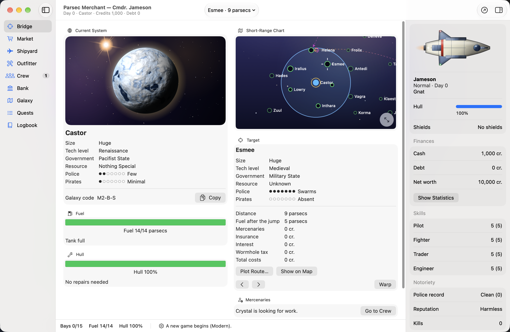
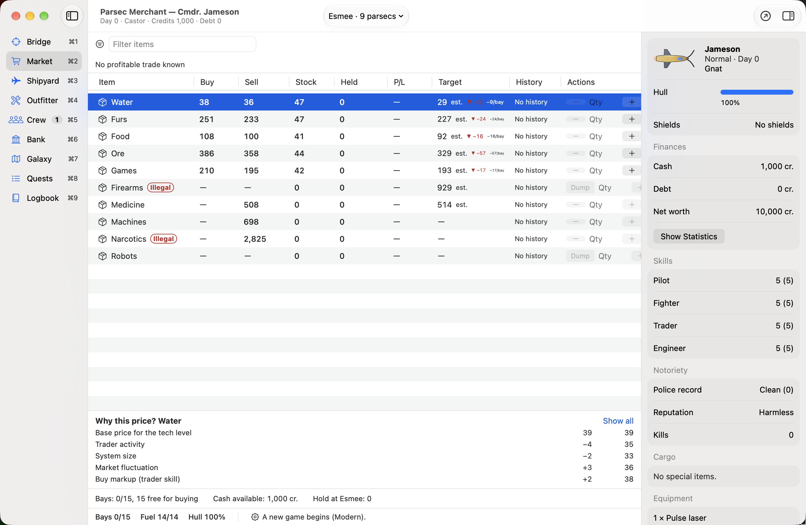
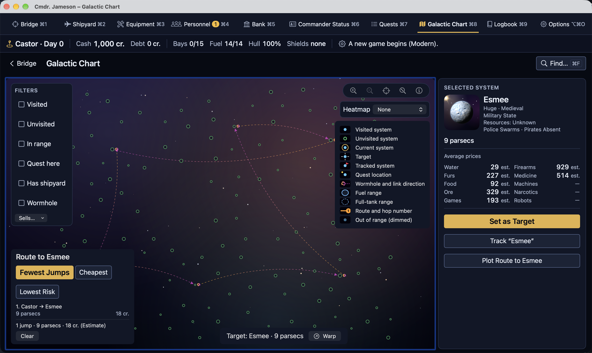
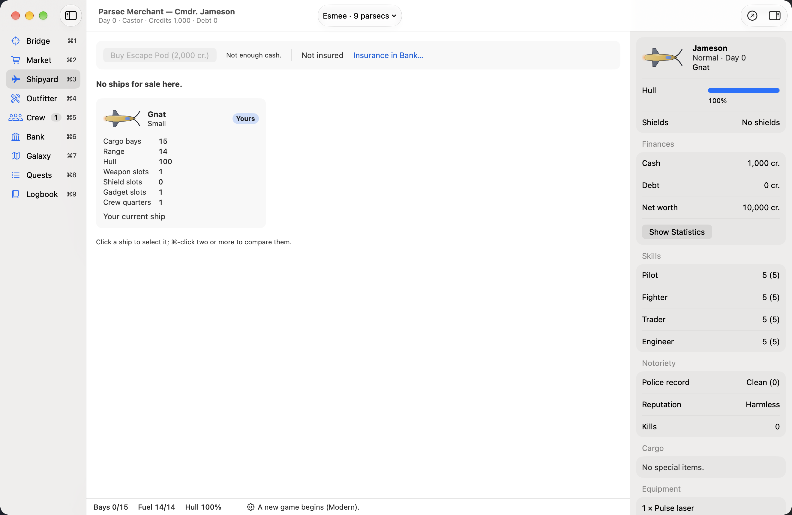

# Parsec Merchant

A native macOS remake of **Space Trader**, Pieter Spronck's classic Palm OS trading game: buy low, sell high, dodge pirates and police, take on quests and earn enough to retire to a moon of your own.

Parsec Merchant runs the original game rules on a new engine and a new SwiftUI interface built for the Mac. All of its art and sound are new.



## Features
- **Three rulesets**, chosen at New Game:
  - **Modern** (default): the Windows 2.01 rules with their bugs fixed (no infinite-money ship trade-ins, no negative fines, and so on).
  - **Windows 2.01**: bit-exact with the C# port, quirks included. It is checked against fixtures produced by a differential harness.
  - **Original Palm 1.2.2**: the Palm rules, with 120 systems, 37 special events, Palm police and scoring. The quirks are kept.
- **One window instead of dozens of screens.** A sidebar for Bridge, Market, Shipyard, Outfitter, Crew, Bank, Galaxy, Quests and the Logbook, plus a ship-status inspector.
- **A merged trade table** shows prices here and at your target, the difference and the profit per bay, with modifier-key quantities.
- **A zoomable galaxy chart** with price and danger heatmaps, hover cards, a route planner and a detachable window.
- **Encounters** with vector ships, hull and shield bars, an animated combat log and keyboard actions. Arrivals collect everything that happened into one report instead of a chain of alerts. The newspaper is a styled page.
- **Trade intelligence, Captain's Log, statistics and achievements**, all stored locally.
- **Optional on-device flavor text** with Apple's Foundation Models where available, and a deterministic template fallback.
- **Synthesized audio and haptics.**
- **Accessibility:** a full keyboard map, VoiceOver labels and rotors, Text Size, and support for Reduce Motion, Increase Contrast, Reduce Transparency and Differentiate Without Color.
- **Saves:** shoebox save slots with autosave, backups, import/export and Ironman mode.

| | |
|---|---|
|  |  |
|  |  |
|  |  |

## Install
Requires **macOS 27** or later.

1. Download `Parsec-Merchant-1.0.0.zip` from the [latest release](https://github.com/megatih/parsec-merchant/releases/latest). The checksum is in the `.sha256` file next to it.
2. Unzip it and move **Parsec Merchant.app** to your Applications folder.
3. Open it. The app is **ad-hoc signed**, not notarized (the project has no paid Apple developer account), so macOS blocks the first launch:
   1. Open the app once and dismiss the warning.
   2. Open **System Settings › Privacy & Security**, scroll to **Security**, and click **Open Anyway** next to the message about Parsec Merchant.
   3. Confirm with your password or Touch ID, then click **Open**.

   After that the app opens normally. Alternatively, build it from source (below).

## Build from source
Requires Xcode 27.2 or later. There are no third-party dependencies.

```sh
git clone https://github.com/megatih/parsec-merchant.git
cd parsec-merchant
xcodebuild -project SpaceTraderMac.xcodeproj -scheme SpaceTraderMac -destination 'platform=macOS' \
  -derivedDataPath build/DD build
open "build/DD/Build/Products/Debug/Parsec Merchant.app"
```

You can also open `SpaceTraderMac.xcodeproj` in Xcode and run the `SpaceTraderMac` scheme. To sign with your own team, put `DEVELOPMENT_TEAM = <your team>` in `Config/Local.xcconfig` (gitignored).

Development:
- `scripts/verify.sh` runs every quality gate: package and app tests, coverage, a 6,000-game fuzz, spec traceability, SwiftLint, the license check and, with `--ui`, the UI tests.
- `swift run --package-path Packages/ParsecKit -c release pmsim` runs the headless simulator (fuzz, bench, bot, scenario).
- `scripts/release.sh` builds the signed release zip.

The design and requirements are in [`docs/PRD.md`](docs/PRD.md), [`docs/design/UX-VISION.md`](docs/design/UX-VISION.md) and [`docs/specs/`](docs/specs).

## Credits
Parsec Merchant is based on **Space Trader** by **Pieter Spronck**, with additional coding by Sam Anderson and Samuel Goldstein. It also draws on **Space Trader for Windows 2.01** by **Jay French** and David Pierron. Full credits are in [CREDITS.md](CREDITS.md) and in the app's About window.

All artwork, icons and sounds are new and drawn in code. None of the original Space Trader images are used. "Space Trader" is named only to credit the original work; this project is not affiliated with HermitWorks Entertainment.

## License
Free software under the **GNU General Public License, version 2 or (at your option) any later version**. See [LICENSE](LICENSE).
